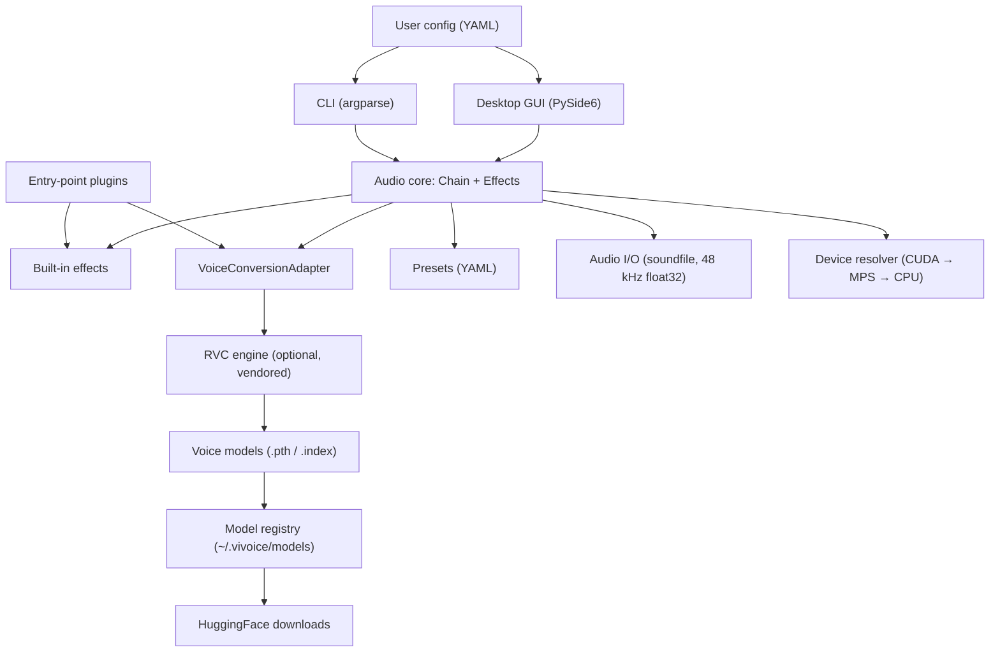

# Architecture

VIvoice is a layered application. Each layer depends only on the one below it,
and the audio core has no knowledge of the GUI, the CLI, or the AI engine.



## Modules

| Path | Responsibility |
| ---- | -------------- |
| `src/vivoice/audio.py` | Audio buffer, 48 kHz float32 convention, WAV/FLAC/OGG I/O |
| `src/vivoice/core/effect.py` | `Effect` abstract base and the effect registry |
| `src/vivoice/core/chain.py` | Ordered effect pipeline and offline file rendering |
| `src/vivoice/effects/` | Built-in effects (gain, pitch, robot, echo, EQ, gate, reverb, voice conversion) |
| `src/vivoice/core/stream.py` | Block-wise `StreamSession` for real-time processing |
| `src/vivoice/presets/` | YAML preset loading, validation, and saving |
| `src/vivoice/models/` | Local voice-model registry and HuggingFace downloads |
| `src/vivoice/ai/` | Compute-device resolver and the `VoiceConversionAdapter` boundary |
| `src/vivoice/gui/` | PySide6 application (thin front-end, no DSP logic) |
| `src/vivoice/cli.py` | Headless command-line front-end |
| `src/vivoice/plugins.py` | Third-party effects/adapters via entry points |
| `src/vivoice/config.py` | Validated user settings in `~/.vivoice/config.yaml` |

## Core contracts

### Effect

Every effect subclasses `Effect` and implements
`process(samples: np.ndarray, context: EffectContext) -> np.ndarray` where
`samples` has shape `(channels, frames)` and dtype `float32`. Effects declare
`required_params` and `default_params`; the registry maps a `type` string to the
class, which is how YAML presets stay decoupled from Python class names.

### VoiceConversionAdapter

AI engines never touch the core. An adapter implements:

```python
class VoiceConversionAdapter(ABC):
    engine: ClassVar[str]
    sample_rate: ClassVar[int]

    @abstractmethod
    def convert(self, audio_mono, voice_model, device, params) -> np.ndarray
```

The `voice-conversion` effect downmixes to mono, resamples to the engine's
native rate (RVC runs at 40 kHz), delegates to the adapter, then resamples back
and restores the channel layout. This keeps engine-specific sample rates out of
the 48 kHz core.

### Device resolution

`resolve_device()` walks `auto → CUDA → MPS → CPU`. `--device` / GUI selection
overrides it. Resolution failures raise `DeviceError`; a missing optional
engine raises `MissingDependencyError` with setup instructions instead of a
crash.

### Streaming and cancellation

`Chain.open_stream()` returns a `StreamSession` that processes
`(channels, frames)` blocks with persistent effect state via
`Effect.process_stream` (defaulting to `process`). Only effects with
`streaming = True` may participate. Effects with `block_process = True` also
let `render_file` process one block at a time — bounded memory, smooth
progress, and per-block cancellation. Both contracts are documented in
[docs/PLUGIN_DEVELOPMENT.md](PLUGIN_DEVELOPMENT.md)). Long-running renders
accept a `should_cancel` callback and raise `Cancelled` at effect boundaries;
the GUI wires this to its Cancel button.

### Plugins and introspection

Installed packages self-register through the `vivoice.effects` and
`vivoice.adapters` entry-point groups. Every effect exposes a JSON-serializable
`params_schema()` (defaults, required flags, numeric bounds, enums), available
as `vivoice effects <type>` and `vivoice schema`, so external tools can build
UIs and validate presets without importing Python.

## Stability rules

- The audio core has no mutable global state; state belongs to effect
  instances.
- Effects must be deterministic for the same input and parameters.
- Heavy work (inference, downloads) runs on worker threads; it never runs on
  the GUI event loop and, in the real-time milestone, never on the audio
  callback.
- Engine-specific rates live inside adapters, not in `Chain`.
- Offline renders call `Effect.reset()` first so results are deterministic;
  streaming sessions reset once when opened and keep state across blocks.

See [docs/adr/](adr/) for the reasoning behind Python (0001), the adapter
boundary (0002), and offline-first delivery (0003).
